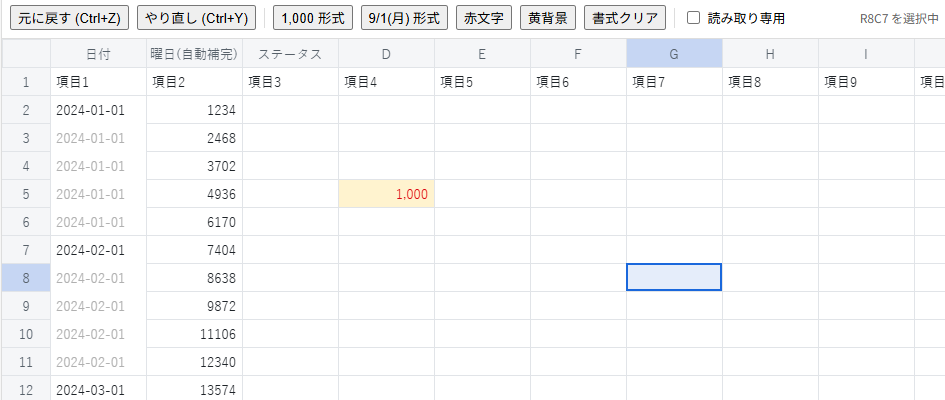

# canvas-table-grid

SolidJS 製・canvas 描画のテーブル／グリッド編集ライブラリ。

「既存のグリッドライブラリの細かい不具合に悩まされるくらいなら、いっそ要件に合わせたものを一から作ってしまおう」ということでAIでつくってみました。




# デモ

[https://gearsns.github.io/canvas-table-grid/index.html](https://gearsns.github.io/canvas-table-grid/index.html)

## 特徴

- **canvas 描画**：セル・グリッド線・ヘッダ・選択範囲をすべて `<canvas>` に描画し、行数×列数が多くても軽快に動作します。
- **日本語入力対応**：見えない `<input>` を裏に常時配置し、IME の変換候補ウィンドウがアクティブセルの位置に正しく表示されます（`compositionstart`/`compositionend` を監視し、変換確定前の Enter/Tab/矢印キーでセル移動しないよう制御）。ダブルクリックで編集を開始する際は、クリックした文字の位置に応じてカーソル（キャレット）位置を推定して配置します（書式なしのセルでは文字単位で厳密に一致、書式ありのセルは表示文字列上の位置を生データの長さに比例配分した近似値になります）。
- **行・列ヘッダ**：ヘッダをクリックで行選択・列選択。ドラッグで複数行／複数列を選択できます。左上コーナークリックで全選択。ヘッダの名前はデフォルトの A,B,C.../1,2,3... 以外に、`columnHeaderLabel`/`rowHeaderLabel` オプションで任意の名前に変更できます（文字列配列でも関数でも指定可能）。
- **マウス範囲選択**：セルをドラッグして矩形範囲を選択。Shift+クリックやShift+矢印キーでも範囲拡張できます。
- **Undo / Redo**：値の変更・書式変更・列幅変更をコマンド単位で履歴管理（`Ctrl+Z` / `Ctrl+Y` / `Ctrl+Shift+Z`）。実行すると、影響したセル範囲へアクティブセル・選択範囲も自動的に移動します（`Ctrl+Z`/`Ctrl+Y`キー操作の場合はスクロールも追従）。
- **列幅リサイズ**：列ヘッダの境界線をドラッグして列幅を変更できます（`col-resize` カーソル表示、最小幅30px、Undo対応）。スクロールバー（表示されている場合のみ）の上ではカーソルが通常の矢印（`default`）に変わります。
- **コピー＆ペースト**：`Ctrl+C`/`Ctrl+X`/`Ctrl+V`（`⌘`も可）でクリップボードと連携。タブ区切りテキスト（TSV）を使うため **Excel・Googleスプレッドシートとの間で範囲コピー／貼り付けが可能**です。コピー中の範囲は点線（マーチングアンツ）で表示され、`Esc`または貼り付けで解除されます。
- **非同期の関連項目補完 + Undoマージ**：`onChange` は非同期関数として使え、渡される `mergeEdits` ヘルパーでサーバーから取得した値を関連セルに反映できます。この補完はユーザーの入力と**同じUndo単位**にまとめられるため、`Ctrl+Z` 1回で入力値と補完値の両方が戻ります。
- **読み取り専用の切り替え**：`readOnly` プロパティ（リアクティブ）で、実行時に閲覧専用へ切り替えられます。詳細は「読み取り専用にする」を参照。
- **行数の可変（自動追加）**：`autoAppendRows: n` を指定すると、最終行のセルに値を入れた（入力・貼り付け・Ctrl+D など）ときに末尾へ n 行追加されます。貼り付け内容が現在の行数を超える場合も、足りない分の行が追加されます。自動追加された行は、その入力と同じ Undo 単位に含まれます。`store.appendRows(n)` / `store.ensureRows(n)` で手動追加も可能（こちらは Undo 対象外）で、行数の変化は `onRowsChange` で受け取れます。
- **ショートカットキーの割り当て変更**：`keyBindings` プロパティで、すべてのショートカットキーを再割り当て・無効化できます。詳細は「ショートカットキーの割り当てを変更する」を参照。
- **ドロップダウン編集**：`dropdownOptions` に判定関数を渡すと、特定のセルだけ編集時にドロップダウンから選択できるようになります。選択肢は同期の配列でも、サーバーから取得する `Promise` でもOK。入力中の文字で絞り込み（インクリメンタルサーチ）もでき、選択肢にない自由なテキスト入力もそのまま可能です。
- **書式のコールバック化（動的書式）**：`getCellFormat` に `(row, col, ctx) => 書式の上書き分` という関数を渡すと、描画のたびに書式を動的に決定できます。`ctx.getCell(row, col)` で任意のセルの値を参照できるので、「1つ上のセルと同じ値なら罫線を消して文字色を薄くし、セルが結合されているように見せる」といった表現をこちら側のロジックで自由に実装できます。
- **書式設定**：セルごとに表示書式（`1000` → `1,000`、`2024-09-01` → `9/1(月)` など）・文字色・背景色・配置（左/中央/右）・太字/斜体を設定可能。表示用の書式と実データを分離しているので、書式を変えても元の値は保持されます。編集中の入力欄にも配置（左/中央/右寄せ）が反映されます。

## セットアップ

```bash
npm install
npm run dev          # example/ の動作確認用デモを起動
npm run typecheck    # 型チェックのみ
npm run test         # ユニットテスト（純粋ロジック部分）を実行
```

`solid-js` は peerDependency です。既存の SolidJS プロジェクトに `src/` を取り込んで使ってください。

## 基本的な使い方

```tsx
import { CanvasTableGrid, type GridStore } from "canvas-table-grid";

let store: GridStore | undefined;

<CanvasTableGrid
  options={{
    rows: 100,
    cols: 26,
    data: initialData, // CellValue[][]（省略時は空グリッド）
  }}
  refStore={(s) => (store = s)}
  onChange={(row, col, value) => console.log(row, col, value)}
  onActiveCellChange={(row, col) => console.log("active:", row, col)}
/>;
```

`ref` で受け取る `GridStore` から、選択中の範囲に対して書式やUndo/Redoを操作できます。

```tsx
// 選択範囲に「1,000」形式を適用
store.setRangeFormat(store.selection().range, { type: "number", pattern: "#,##0" });

// 選択範囲に「9/1(月)」形式を適用
store.setRangeFormat(store.selection().range, { type: "date", pattern: "M/D(ddd)" });

// 文字色・背景色
store.setRangeFormat(store.selection().range, { color: "#d00000", background: "#fff3cd" });

// カスタム書式関数（type/pattern より優先）
store.setRangeFormat(store.selection().range, {
  formatter: (v) => (v == null ? "" : `¥${v}`),
});

store.undo();
store.redo();
```

## 列・行ヘッダの名前を変える

デフォルトでは列ヘッダは `A, B, C, ...`、行ヘッダは `1, 2, 3, ...` ですが、`options.columnHeaderLabel` / `options.rowHeaderLabel` で任意の名前に変更できます。文字列配列（インデックス対応）でも、関数でも指定できます。

```tsx
<CanvasTableGrid
  options={{
    rows: 100,
    cols: 5,
    // 配列で指定: 足りない分（5列目以降など）は既定のA,B,C…にフォールバックする
    columnHeaderLabel: ["日付", "商品名", "数量", "単価", "小計"],
    // 関数で動的に決めることもできる
    rowHeaderLabel: (i) => `#${i + 1}`,
  }}
/>
```

これはヘッダ（列名・行番号が出る固定行/列）の見た目だけを変えるものです。1行目のデータそのものを見出し行として使いたい場合は、`data` の1行目に見出しの文字列を入れて（`row: 0` を見出し行として扱う）、通常のセルとして表示・編集できるようにする方法もあります（`example/App.tsx` の1行目「項目1」「項目2」...がその例です）。

## サーバーから非同期に関連項目を補完する（Undoを1回にまとめる／処理順を保証）

`onChange` は `(row, col, value, helpers) => void | Promise<void>` の形で呼ばれます。返した Promise が解決するまで、ライブラリ側で以下を保証します。

- **直列実行**：新しい編集は `busy()` の間そもそも開始できないため（下記）、`onChange` の呼び出しが重なって順序が入れ替わることはありません。
- **処理中はロック**：`onChange` の Promise が解決するまでの間、セルの編集開始・削除・切り取り・貼り付け・Undo/Redo は無効になります（キャンバスのカーソルは `wait` になります）。範囲選択やスクロール、列幅リサイズは引き続き行えます。
- **同じUndo単位にマージ**：`helpers.mergeEdits([{ row, col, value }, ...])` を呼ぶと、その変更が今回のセル編集と同じUndoコマンドに追記されます。`Ctrl+Z` を1回押すだけで「ユーザーが入力した値」と「サーバーから補完された関連セルの値」の両方が一緒に取り消されます。

```tsx
<CanvasTableGrid
  options={{ rows: 100, cols: 26 }}
  onBusyChange={(busy) => setLoading(busy)} // ローディング表示などに利用
  onChange={async (row, col, value, { mergeEdits }) => {
    // 例: A列(col===0)に日付を入れたら、サーバーから曜日を取得してB列に自動補完
    if (col !== 0) return;
    const youbi = await fetch(`/api/youbi?date=${value}`).then((r) => r.text());
    mergeEdits([{ row, col: 1, value: youbi }]);
  }}
/>
```

**マージの挙動**：
- 補完のタイミングで、直前に積まれたUndoコマンドがまだスタックの一番上にある場合 → 同じコマンドに追記され、1回のUndo/Redoでまとめて扱われます（ロック機構により、通常は常にこちらのケースになります）。
- 途中で別の編集やUndo/Redoが挟まった場合（例：`onChange` を持たないプログラム的な操作が別途行われた場合） → 整合性のため、補完値は独立した新しいUndoコマンドとして積まれます（安全側へのフォールバック）。

貼り付け（`Ctrl+V`）でも同様に、貼り付けた範囲の左上セルを起点として `onChange` が呼ばれ、`mergeEdits` で貼り付け内容と同じUndo単位に補完値を追加できます。

## ダブルクリックをフックする

`onCellDoubleClick` に、ダブルクリックされたセルの情報を受け取る関数を渡します。

```tsx
<CanvasTableGrid
  options={{ rows: 20, cols: 5 }}
  onCellDoubleClick={({ row, col, value, displayValue, event }) => {
    console.log(`R${row + 1}C${col + 1}`, value, displayValue);
    if (col === 3) {
      openMyDialog(row, col, value); // 独自のダイアログなどを開く
      return false;                  // false を返すと、通常の編集開始をキャンセルする
    }
  }}
/>
```

| 引数のフィールド | 内容 |
| --- | --- |
| `row` / `col` | ダブルクリックされたセルの位置（0始まり） |
| `value` | セルに保存されている生の値 |
| `displayValue` | canvas に表示されている文字列（書式適用後。`1000` が `1,000` のような値） |
| `event` | 2回目のクリックの `PointerEvent` |

- ダブルクリックの判定は、同じセルを 400ms 以内・4px 以内で 2 回クリックしたときです。
- ダブルクリックしたセルは、フックが呼ばれる前に選択状態になっています。
- 読み取り専用（`readOnly`）や `onChange` の処理中でも呼ばれます（このとき編集は元々開始されません）。
- ヘッダ（行・列ヘッダ）のダブルクリックは対象外です。
- Shift を押しながらのクリックはダブルクリックとして扱いません。

## 読み取り専用にする

```tsx
const [readOnly, setReadOnly] = createSignal(false);

<CanvasTableGrid options={{ rows: 20, cols: 5 }} readOnly={readOnly()} />
<button onClick={() => setReadOnly(!readOnly())}>切り替え</button>
```

`readOnly` が `true` の間の挙動：

| できる | できない |
| --- | --- |
| セル・行・列の選択、範囲選択 | ダブルクリック・F2・文字入力（IME含む）による編集開始 |
| 矢印・Home/End などのカーソル移動、スクロール | Delete/Backspace による削除 |
| コピー（`Ctrl+C`） | 貼り付け、`Ctrl+D`、`Ctrl+;` / `Ctrl+Shift+:` |
| 列幅の変更 | Undo / Redo |
| 切り取り（`Ctrl+X`）はコピーとして動作（値は消えません） | ドロップダウンの表示・選択（編集を開始できないため） |

- 編集中に `readOnly` を `true` にすると、入力中の内容は**破棄**され、編集が終了します。
- `readOnly` は画面からの操作だけを止めます。`store.setCellValue()` などをプログラムから直接呼べば、読み取り専用中でも値は変更できます。
- セル単位（特定の列だけ編集不可など）の制御は未対応です。

## 行数を途中で増やす

```tsx
<CanvasTableGrid
  options={{
    rows: 20,
    cols: 5,
    autoAppendRows: 10, // 最終行に値を入れるたびに、末尾へ10行追加（省略/0なら行数固定）
  }}
  onRowsChange={(rows) => console.log("行数:", rows)}
/>
```

- 追加されるのは「最終行のセルに**値が入る**変更」があったときです（値を空にする変更では追加されません）。入力・貼り付け・Ctrl+D・`mergeEdits` による補完のいずれも対象です。
- 貼り付けは、内容が現在の行数を超える場合に足りない分の行を追加して、全部貼り付けます。
- **自動追加された行は Undo / Redo の対象**です。最終行への入力（や貼り付け・Ctrl+D・`mergeEdits` の補完）を Undo すると、値と一緒に、その操作で増えた行も取り除かれます（Redo で再び追加されます）。1回の Undo で入力・補完・行追加がまとめて戻ります。
- 手動で追加する `store.appendRows(n)`（n行追加）／`store.ensureRows(minRows)`（minRows 行になるまで追加）は Undo 履歴に積まれず、Undo しても残ります。
- 増やせるのは行だけで、列数は固定です。行の削除・挿入は未実装です。

## 特定のセルをドロップダウン編集にする

`dropdownOptions` プロパティに `(row, col) => DropdownOption[] | Promise<DropdownOption[]> | null | undefined` の形の関数を渡します。編集開始時にこの関数が呼ばれ、戻り値によって挙動が決まります。

- `null` / `undefined` を返す → そのセルは通常のテキスト編集（ドロップダウンなし）
- 配列を返す → 同期的にその場でドロップダウン表示
- `Promise` を返す → 「読み込み中…」を表示しつつ非同期取得し、解決したら選択肢を表示（サーバーからの取得に対応）

```tsx
<CanvasTableGrid
  options={{ rows: 100, cols: 26 }}
  dropdownOptions={(row, col) => {
    if (col !== 2) return undefined; // C列だけドロップダウン対応
    return fetch(`/api/status-options`).then((r) => r.json()); // [{ value, label }, ...] を返す想定
  }}
/>
```

**操作方法**：
- ダブルクリック／F2／直接入力のいずれでも編集開始時にドロップダウンが開きます。
- 入力した文字で選択肢が絞り込まれます（`label`、なければ `value` の文字列表現に対して部分一致）。
- `↓`/`↑` キーで選択肢をハイライトし、`Enter`（または`Tab`）で確定、クリックでも選択できます。
- 明示的に矢印キーでハイライトしていない状態で `Enter`/`Tab` を押した場合は、ドロップダウンを使わず**入力した文字列がそのままセルの値**になります（選択肢にない自由入力も可能）。
- `Escape` で編集自体をキャンセルします（ドロップダウンも閉じます）。

選択肢の `value` はそのままセルの値として `setCellValue` に渡されるため、`onChange` や書式設定と組み合わせて使えます。

## 書式をコールバックで動的に決める（結合セット風の表現など）

`getCellFormat` は描画のたびに呼ばれ、`store.setRangeFormat` 等で保存されている基本書式（`baseFormat`）に対する**上書き分だけ**を返す関数です。変えたいプロパティだけ返せばよく、`undefined` を返せば基本書式のままになります。

```tsx
<CanvasTableGrid
  options={{ rows: 100, cols: 26 }}
  getCellFormat={(row, col, { value, getCell, baseFormat }) => {
    // A列(col===0)で、1つ上のセルと同じ値なら「結合されているように」見せる
    if (col !== 0 || row === 0) return undefined;
    const above = getCell(row - 1, col);
    if (above !== null && above === value) {
      return { border: { top: false }, color: "#b0b0b0" };
    }
    return undefined;
  }}
/>
```

**罫線の仕組み**：各セルは自分の**上辺**と**左辺**の罫線だけを描画します（右・下の罫線は、右や下のセルの左・上として描かれる1本と同じ線なので、二重に描かないようにするための設計です）。そのため、あるセルの上に罫線を出したくない場合は、そのセル自身に `border: { top: false }` を返してください。1つ下のセルに `border.bottom` のような指定をしても効果はありません（`bottom`/`right` は用意していません）。

`ctx.getCell(row, col)` は任意のセル（上下左右問わず）の値を参照できるので、行方向だけでなく列方向の比較や、もっと複雑な条件（複数列の組み合わせなど）による動的な書式づけにも使えます。

## 書式パターンの書き方

### 数値 (`type: "number"`)

| pattern       | 値      | 表示        |
| ------------- | ------- | ----------- |
| `#,##0`       | `1000`  | `1,000`     |
| `#,##0.00`    | `1000.5`| `1,000.50`  |
| `0.0%`        | `0.125` | `12.5%`     |

### 日付 (`type: "date"`)

トークン: `YYYY` `YY` `MM` `M` `DD` `D` `hh` `mm` `ss` `ddd`(月/火/…) `dddd`(月曜日/…)

| pattern         | 値            | 表示           |
| --------------- | ------------- | -------------- |
| `YYYY/MM/DD`    | `2024-09-01`  | `2024/09/01`   |
| `M/D(ddd)`      | `2024-09-01`  | `9/1(日)`      |

## API 概要

- `CanvasTableGrid` — メインの SolidJS コンポーネント。
- `createGridStore(options)` — 状態（データ・選択・Undo履歴・スクロール）を作る低レベル API。コンポーネント内部で使用。
- `GridStore`
  - `getCell(row, col)` / `setCellValue(row, col, value)` — 戻り値は `EditToken`（`mergeCellEdits` 用）
  - `mergeCellEdits(token, changes)` — 非同期補完などを既存のUndoコマンドにマージ、または独立コマンドとして追加
  - `setRangeValues(range, (row, col) => value)` — 貼り付け等、複数セルの一括変更（Undoは1単位、戻り値は `EditToken`）
  - `getFormat(row, col)` / `setRangeFormat(range, format)`
  - `clearRange(range)` — Delete/Backspace相当
  - `fillDown(range)` — 先頭行（単一行選択なら1つ上の行）の値と書式を下方向へコピー（Ctrl+D相当、Undoは1単位）
  - `findUsedRange()` — データが入っている最も右・最も下のセルを返す（Ctrl+End の移動先）
  - `selection()` / `activeCell()` / `editingCell()`
  - `selectCell(row, col, extend?)` / `selectRow(row, extend?)` / `selectColumn(col, extend?)` / `selectAll()`
  - `undo()` / `redo()` / `canUndo()` / `canRedo()`
- `formatCellValue(value, format)` / `formatNumber(value, pattern)` / `formatDate(value, pattern)`

## ショートカットキーの割り当てを変更する

すべてのショートカットキーは `src/lib/keymap.ts` の `defaultKeyBindings` に集約されており、`keyBindings` プロパティで一部だけ上書きできます。

```tsx
<CanvasTableGrid
  options={{ rows: 20, cols: 5 }}
  keyBindings={{
    undo: [{ key: "u", mod: true }],   // Ctrl+Z の代わりに Ctrl+U で元に戻す
    fillDown: [{ key: "g", mod: true }], // Ctrl+D の代わりに Ctrl+G
    selectAll: null,                    // Ctrl+A のショートカットを無効化する
  }}
/>
```

- 配列で指定するとデフォルトを**置き換え**ます（1つのアクションに複数のキーを割り当てることも可能。例: `redo` は既定で `Ctrl+Y` と `Ctrl+Shift+Z` の両方に割り当てられています）。
- `null` を指定するとそのショートカット自体を無効化できます。
- 指定しなかったアクションは既定のままです。
- `key` は `KeyboardEvent.key` の値（大文字小文字は区別しません）。`mod` は Ctrl（Win/Linux）または Cmd（Mac）が必須かどうかです。
- 矢印キー・Home・End・Enter・Tab の `Shift` や、Enterの `Alt` は「範囲選択の拡張」「上方向への移動」「編集開始」などの補助的な意味を持つため、これらのキー自体はバインディングの対象ですが、Shift/Altの有無による意味の違いまでは変更できません（例：`arrowUp` のキーは変更できますが、「Shiftを押すと選択範囲が拡張される」という挙動自体は固定です）。

アクション一覧とデフォルトのキー割り当ては `src/lib/keymap.ts` の `defaultKeyBindings` を参照してください。

## キー操作

編集中でないとき（セル選択状態）のキー操作です。編集中の `Home`/`End`/矢印キーは通常のテキスト編集としてカーソルが動きます。

| キー                          | 動作                                                         |
| ----------------------------- | ------------------------------------------------------------ |
| 矢印キー                      | アクティブセル移動                                           |
| Shift + 矢印キー              | 選択範囲を拡張                                               |
| Home                          | 現在の行の先頭列（A列など）へ移動                            |
| Shift + Home                  | カーソル位置から行の先頭までを選択                           |
| Ctrl(⌘) + Home                | ワークシートの先頭 (A1) セルへ移動                           |
| End                           | 現在の行の最終列へ移動（Shift+Endで行末まで選択）            |
| Ctrl(⌘) + End                 | データが入っている最も右・最も下のセルへ移動                 |
| 文字入力 / IME変換            | そのまま入力してセル編集を開始                               |
| F2                            | 既存値の末尾にカーソルを置いて編集開始                       |
| Enter / Shift+Enter           | 確定して下／上へ移動（Alt+Enterで編集開始）                  |
| Tab / Shift+Tab               | 確定して右／左へ移動                                         |
| Escape                        | 編集をキャンセル（コピー中の点線も解除）                     |
| Delete / Backspace            | 選択範囲の内容を削除                                         |
| Ctrl(⌘) + Z / Ctrl(⌘) + Y     | Undo / Redo（Ctrl+Shift+Z でも Redo）                        |
| Ctrl(⌘) + A                   | 全選択                                                       |
| Ctrl(⌘) + C / X / V           | コピー／切り取り／貼り付け（Excel等と連携可）                |
| Ctrl(⌘) + D                   | 選択範囲内で、上のセルの内容と書式を下方向にコピー（下記参照）|
| Ctrl(⌘) + ;                   | 今日の日付を入力（`YYYY/MM/DD`）                             |
| Ctrl(⌘) + Shift + :           | 現在の時刻を入力（`HH:MM`）                                  |
| ↓ / ↑（ドロップダウン表示中） | 選択肢のハイライト移動                                       |
| ヘッダクリック                | 行選択 / 列選択（ドラッグで複数選択）                        |
| 左上コーナークリック          | 全選択                                                       |

**Ctrl+D（下方向へコピー）の動作**：
- 1つのセル（1行）だけ選択している場合 → 1つ上のセルの値と書式を、選択中のセルにコピーします。
- 複数行を選択している場合 → 選択範囲の**先頭行**の値と書式を、2行目以降のすべての行にコピーします。列ごとに対応するセルの内容がコピーされます。
- 1回の Undo でまとめて元に戻せます。

**Ctrl+; / Ctrl+Shift+:（日付・時刻の入力）**：編集中でないときはアクティブセルの値をその場で日付/時刻に置き換えます。セルを編集中のときは、入力欄のカーソル位置に挿入します。

